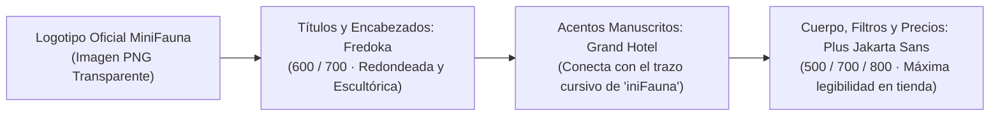

# 🌿 Libro de Estilos Oficial — MiniFauna (Brand & UI Design System)

> [!IMPORTANT]
> **ADN Gráfico de la Marca:** El universo visual de **MiniFauna** nace directamente de su logotipo escultórico: una fusión entre **naturaleza botánica viva** (lianas entrelazadas, hojas de monstera, brotes tiernos y flores tropicales) y **artesanía táctil en 3D** (volúmenes redondeados tipo arcilla polimérica / impresión 3D multicolor con textura tallada en turquesa jade).

---

## 1. Anatomía del Logotipo Oficial

| Elemento del Logo | Rasgo Gráfico | Traducción al Diseño Web & 3D |
| :--- | :--- | :--- |
| **Monograma "M" de Lianas** | Doble arco en forma de corazón formado por tallos verdes entrelazados con hojas tropicales y flores de 5 pétalos. | Estructura orgánica curva en contenedores (`border-radius: 24px - 32px`), bordes vegetales suaves y ausencia de esquinas cortantes. |
| **Caligrafía *"iniFauna"* Tallada** | Letra cursiva gruesa en **Turquesa Jade (`#28968C`)** con surcos longitudinales estilo madera/filamento tallado y volumen 3D. | Botones principales, títulos destacados y píldoras con acabado **Clay-3D** (borde inferior en sombra `#1B6B63` y bisel superior luminoso `#5CC8BE`). |
| **Brotes de Hojas (`#9CCC3D`)** | Pequeñas hojitas verde lima que brotan directamente de los trazos de la *n*, *F* y *a*, más un zarcillo en espiral bajo la *F*. | Micro-ornamentos SVG de brotes botánicos en botones de llamada a la acción (CTA), encabezados de sección y marcadores del globo. |
| **Flores de Arcilla (Papaya y Orquídea)** | Flores de 5 pétalos redondeados en **Melocotón-Papaya (`#F58E58`)** y **Rosa Orquídea (`#F28BB2`)** con pistilo amarillo (`#FCD34D`). | Colores de acento para insignias de *Top Ventas*, precios, contador de carrito, botones de favoritos y pines de biomas cálidos. |

---

## 2. Paleta Cromática Oficial (Extraída por Muestreo Directo del Logo)

### A. Colores Primarios (Botánica & Turquesa Jade)
| Muestra | Nombre del Token | Variable CSS | Código HEX | RGB | Uso en el Proyecto |
| :---: | :--- | :--- | :---: | :---: | :--- |
| 🟦 | **Lagoon Jade (Caligrafía)** | `--mf-lagoon` | `#28968C` | `40, 150, 140` | Color corporativo principal, botones primarios, enlaces activos y océanos costeros del globo. |
| 🌊 | **Deep Carved Teal (Sombra)** | `--mf-lagoon-dark` | `#1A665F` | `26, 102, 95` | Relieve 3D inferior de botones, textos de alto contraste, cabeceras y bordes activos. |
| 🌿 | **Jungle Monstera (Follaje)** | `--mf-emerald` | `#2E8B57` | `46, 139, 87` | Hojas tropicales del logo, indicadores de validación zoológica y biomas selváticos. |
| 🌱 | **Vine Forest (Liana Oscura)** | `--mf-vine-dark` | `#243E1E` | `36, 62, 30` | Tipografía principal (sustituye al negro puro por un verde bosque profundo mucho más cálido y orgánico) y fondo del Footer. |
| 🍃 | **Sprout Lime (Brote Tierno)** | `--mf-lime` | `#9CCC3D` | `156, 204, 61` | Hojitas superiores del logo, píldoras destacadas, iluminación de selección 3D y estados activos. |

### B. Colores Secundarios de Floración (Acentos Cálidos)
| Muestra | Nombre del Token | Variable CSS | Código HEX | RGB | Uso en el Proyecto |
| :---: | :--- | :--- | :---: | :---: | :--- |
| 🌼 | **Papaya Blossom (Flor Naranja)** | `--mf-papaya` | `#F58E58` | `245, 142, 88` | Flores naranjas de la "M": botones de compra rápida, marcadores ocupados y alertas cálidas. |
| 🌸 | **Orchid Hibiscus (Flor Rosa)** | `--mf-orchid` | `#F28BB2` | `242, 139, 178` | Flores rosas de la "M": botón de Favoritos (Wishlist), insignias de colección y detalles kawaii. |
| ☀️ | **Pollen Gold (Pistilo)** | `--mf-pollen` | `#FCD34D` | `252, 211, 77` | Centro de las flores: estrellas de valoración (`★ 5.0`), línea de los trópicos y acentos solares. |

### C. Fondos y Superficies Luminosas
| Muestra | Nombre del Token | Variable CSS | Código HEX | Uso en el Proyecto |
| :---: | :--- | :--- | :---: | :--- |
| 🤍 | **Botanical Alabaster** | `--mf-bg-page` | `#F6FBF7` | Fondo general de la página con bruma suave verde menta y flor de melocotón. |
| 🍵 | **Soft Mint Card** | `--mf-bg-tint` | `#E8F5EE` | Fondos de selectores, cajas de información de hábitat y pestañas inactivas. |

---

## 3. Sistema Tipográfico Sincronizado

- **Títulos de Sección (`Fredoka Bold`)**: Formas gruesas y terminaciones esféricas que imitan el volumen modelado en 3D de las letras y lianas del logotipo.
- **Gradiente Textual Botánico (`.text-gradient-botanical`)**: Degradado fluido entre **Vine Forest (`#2E8B57`)**, **Lagoon Jade (`#28968C`)** y **Sprout Lime (`#82B828`)**.

---

## 4. Lenguaje de Componentes "Tactile 3D Clay & Vine"

1. **Botones con Relieve Tallado (`.btn-clay`)**:
   - Inspirados en el relieve tridimensional de las letras *"iniFauna"*: incorporan un bisel superior luminoso (`inset 0 2px 0 rgba(255,255,255,0.45)`) y un borde inferior sólido de 3px (`#1A665F` o `#C96A38`) que se comprime suavemente al hacer clic (`transform: translateY(2px)`).
2. **Tarjetas de Producto Botánicas (`.product-card`)**:
   - Bordes redondeados de `24px` en verde agua suave (`#CDE5DC`), sombra ambiental orgánica y al pasar el ratón despliegan un halo verde lima (`#9CCC3D`) con elevación táctil.
3. **Sincronización con el Motor WebGL (Three.js)**:
   - Los océanos del globo terráqueo adoptan la gama **Lagoon Jade / Aguamarina luminosa**, los continentes lucen los verdes **Jungle Monstera (`#2E8B57`)** y **Sprout Lime (`#9CCC3D`)** con desiertos en **Papaya/Pollen (`#F58E58` / `#FCD34D`)**, y los materiales de las figuras mantienen la rugosidad satinada (`roughness: 0.52`) idéntica a la textura del logotipo.
